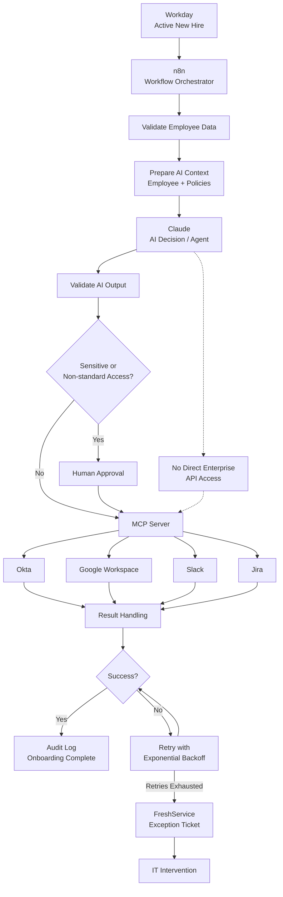

# HeliosHR AI-Powered Employee Onboarding Architecture

## Architecture Overview

The onboarding workflow starts when a new hire becomes active in Workday. n8n acts as the workflow orchestration layer and coordinates validation, AI decision-making, approvals, provisioning, retries, and audit logging.

Claude acts as the AI decision and orchestration layer. It analyzes the employee information and determines the appropriate onboarding actions based on predefined policies.

Claude does not directly access enterprise systems. All enterprise operations are exposed through a secure MCP server with allow-listed tools and authorization controls.

## High-Level Architecture

```text
                         ┌─────────────────────┐
                         │       Workday       │
                         │  New Hire / Active  │
                         └──────────┬──────────┘
                                    │
                                    ▼
                         ┌─────────────────────┐
                         │        n8n          │
                         │ Workflow Orchestrator│
                         └──────────┬──────────┘
                                    │
                         Validate Employee Data
                                    │
                                    ▼
                         ┌─────────────────────┐
                         │   Prepare AI Context│
                         │ Employee + Policies │
                         └──────────┬──────────┘
                                    │
                                    ▼
                         ┌─────────────────────┐
                         │       Claude        │
                         │ AI Decision / Agent │
                         └──────────┬──────────┘
                                    │
                         Structured Action Plan
                                    │
                                    ▼
                         ┌─────────────────────┐
                         │  Output Validation │
                         └──────────┬──────────┘
                                    │
                          ┌─────────┴─────────┐
                          │                   │
                    Standard Access     Sensitive Access
                          │                   │
                          │             Human Approval
                          │                   │
                          └─────────┬─────────┘
                                    │
                                    ▼
                         ┌─────────────────────┐
                         │      MCP Server     │
                         │ Secure Tool Layer   │
                         └──────────┬──────────┘
                                    │
              ┌─────────────────────┼─────────────────────┐
              │                     │                     │
              ▼                     ▼                     ▼
       ┌─────────────┐       ┌─────────────┐       ┌─────────────┐
       │    Okta     │       │   Google    │       │    Slack    │
       │ User/Groups │       │ Workspace   │       │ User/Access │
       └─────────────┘       └─────────────┘       └─────────────┘
              │
              │
              ▼
       ┌─────────────┐       ┌─────────────┐
       │    Jira     │       │ FreshService│
       │ User/Access │       │ Exceptions  │
       └─────────────┘       └─────────────┘

                         ┌─────────────────────┐
                         │ Audit / Monitoring  │
                         │ Execution + Results │
                         └─────────────────────┘


## Mermaid Architecture Diagram



### Architecture Principles

- **Workday** is the source of truth for employee lifecycle events.
- **n8n** controls workflow execution.
- **Claude** makes onboarding decisions using approved employee data and policies.
- **MCP** provides a controlled execution boundary between AI and enterprise systems.
- **Human approval** is required for sensitive or non-standard access.
- **Retries and FreshService escalation** handle operational failures.
- **Audit logging** records the complete onboarding execution.
- Claude does not directly access enterprise APIs or credentials.
```

Save the file.

This makes the architecture much easier for a reviewer to understand on GitHub, while your existing ASCII diagram can remain as a fallback.

**Don't commit yet.** Tell me `done` after saving.